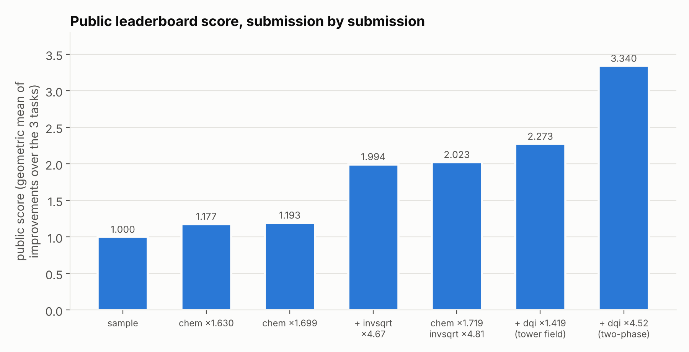
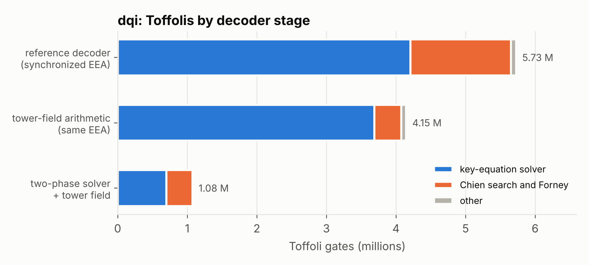

# Verifiable quantum circuit compilation

My entry to the Kaggle competition
[Google Quantum AI – Verifiable Quantum Circuit Compilation](https://www.kaggle.com/competitions/google-verifiable-quantum-circuit-compilation).
The competition has three benchmarks, each a piece of a fault-tolerant quantum algorithm. For each one, the goal is
to make the circuit cheaper to run and prove it with the organizers' verifier, which simulates the circuit or checks
the submitted data exactly.

| Benchmark | What the circuit does | Cost measured | Reference → this work | Improvement |
|---|---|---|---|---|
| [**Chemistry**](chemistry/) (`dfthcsos`) | Block-encodes the FeMoCo Hamiltonian (nitrogenase active site) for phase estimation | λ_eff · T · Q | 3.356 × 10⁹ → 1.952 × 10⁹ | **×1.719** |
| [**invsqrt**](invsqrt/) | Applies the phase e^{2πi/√x} to an integer register | Q · C | 2,076,774 → 431,442 | **×4.81** |
| [**dqi**](dqi/) | Decodes a Reed–Solomon code inside Decoded Quantum Interferometry | R · Q² · T | 2.444 × 10¹³ → 5.407 × 10¹² | **×4.52** |

The competition score is the geometric mean of the three improvements: **3.340** on the public leaderboard.



## How the work was done

- **The verifier is the judge.** Every number in this repository comes from the official verifiers. The local runs
  reproduced the leaderboard to the last digit, so each submission was known to pass, and what it would score,
  before it was sent.
- **Measure first, then attack the biggest cost.** Each benchmark starts with a cost breakdown: a closed-form cost
  model for chemistry, per-stage Toffoli counts for invsqrt and dqi. The improvements went where the cost was.
- **Exact models before circuits.** The invsqrt design has an exact integer model of the circuit, so its worst error
  over all 3.1 million inputs is known before anything is built. The new dqi algorithm ran on a classical model
  over 118,000 simulated shots, which also sized its registers, before it became a circuit; its field arithmetic is
  tested exhaustively in simulation.
- **Own work only.** Public notebooks were read to understand the state of the art in chemistry
  ([gap analysis](chemistry/README.md#gap-analysis)) but no public circuit or factorization was reused.

## The three benchmarks

**[Chemistry](chemistry/README.md).** The two-electron tensor of FeMoCo (76 orbitals) is compressed with a
double-factorized tensor hypercontraction. Eleven rounds of GPU training explored the factorization shape, the
rotation precision and the error budget. A very different shape (8 ranks of 143 bases instead of 65 of 60) cut the
Toffoli count by 59%, and spending the remaining error margin on the normalization λ_eff brought the improvement to
×1.719.

**[invsqrt](invsqrt/README.md).** The reference computes 1/√x with Newton–Raphson. The replacement normalizes x bit
by bit, reads a 256-entry table of piecewise-quadratic coefficients, and evaluates the polynomial with truncated
Horner steps tuned by greedy search: 40% fewer qubits and 67% fewer Toffolis.

**[dqi](dqi/README.md).** Two steps.
- **Field arithmetic.** Rewriting GF(2¹²) as a tower GF(((2³)²)²) turns every multiplication and inversion into a
  network of AND gates that is uncomputed by measurement: inversion drops from 315 Toffolis to 78, multiplication
  from 63 to 54 (×1.42).
- **The decoding algorithm.** The reference's reversible Euclidean algorithm pays for all of its data-dependent
  sub-steps in every one of 222 iterations. I replaced it with a key-equation solver of my own design with a fixed
  schedule of 2 × 70 steps: Bernstein–Yang divsteps whose quotients are stashed, for free, in the registers that
  the division by x releases, then a replay of the transition matrices that rebuilds σ and ω and pops the stash.
  The algorithm was checked on a classical model first. Toffolis dropped from 4.15 M to 1.08 M (×4.52 overall).



## Repository layout

```
chemistry/   training, quantization and submission code; Kaggle notebooks; logs and experiment table
invsqrt/     polynomial design, exact error model, optimizer, full verification
dqi/         two-phase decoder, its classical model, tower-field arithmetic, tests, profiling
figures/     overview figures (scripts/make_figures.py)
results/     leaderboard history
```

## Running it

The competition data (the `kickmix` simulator, the verifiers, the FeMoCo Hamiltonian) belongs to the organizers and
is not redistributed. Download it from the competition page and point `COMP_DIR` at the folder that holds
`kickmix/` and `verifiers/`:

```bash
export COMP_DIR=/path/to/competition-data
python -m pytest dqi/tests -q          # tower field, classical model, full decoder (~1 min)
python invsqrt/build.py invsqrt.kmb    # the submitted invsqrt circuit
python dqi/decoder.py dqi.kmb          # the submitted dqi circuit (~30 s, 488 MB)
python scripts/make_figures.py         # overview figures
```

The chemistry experiments ran on Kaggle GPUs; see [chemistry/README.md](chemistry/README.md#reproducing).
Requirements: NumPy, pandas and matplotlib; JAX for chemistry training; pytest for the tests. Everything here
was run with Python 3.13, the version of the Kaggle images the competition's `kickmix` binary was used on.

## Credits

- Google Quantum AI: problems, verifiers, the `kickmix` simulator, the reference circuits and the chemistry starter
  kit (DF-THC-SOS trainer). The first dqi decoder subclasses the organizers' reference implementation of the
  Proos–Zalka synchronized extended Euclidean algorithm. The second one adapts the divstep of D. J. Bernstein and
  B.-Y. Yang, "Fast constant-time gcd computation and modular inversion" (2019), to reversible circuits.
- Public competition notebooks by ozertuu and mrmeows, read for the chemistry gap analysis only.
- Developed with an AI assistant (Claude) as a pair programmer. Design decisions, runs and analysis are documented
  in each folder.

## License

The code in this repository is released under the [MIT License](LICENSE). Competition data, verifiers and the
starter kit belong to their authors and are not covered by it.
