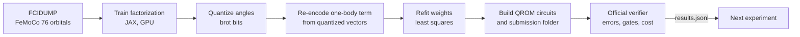
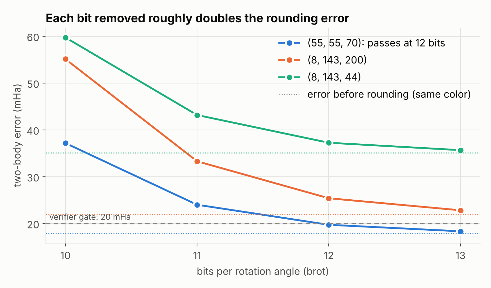
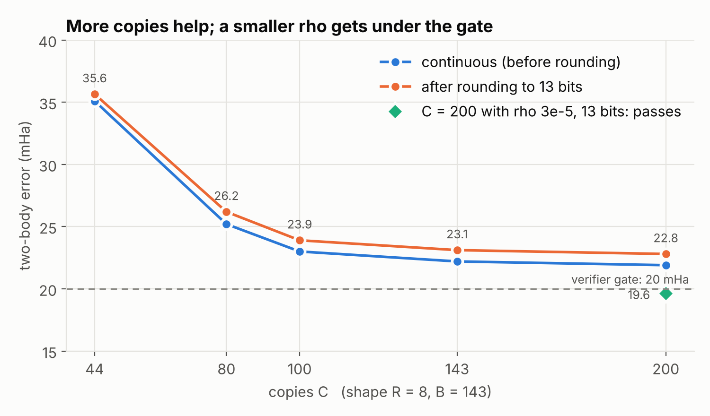
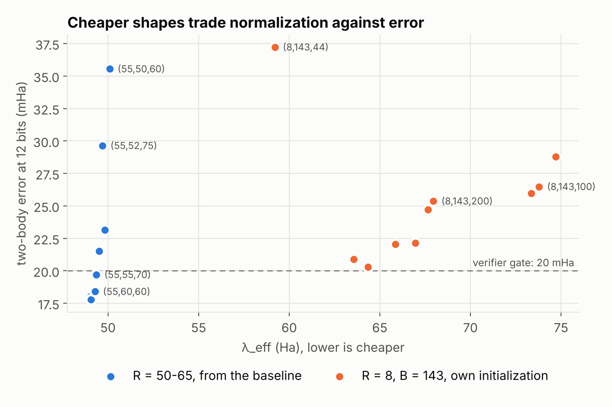

# Chemistry: compressing the FeMoCo Hamiltonian for quantum phase estimation

Benchmark III of the competition (`dfthcsos`): make a fault-tolerant quantum algorithm for the FeMoCo cofactor of
nitrogenase cheaper to run, and prove it with the official verifier.

| | Baseline (organizers) | This work, best verified | Public state of the art (for reference) |
|---|---|---|---|
| Factorization shape (R, B, C) | (65, 60, 60) | (8, 143, 200) | (8, 143, 44) |
| Rotation precision | 12 bits | 13 bits | 8 bits |
| λ_eff (Ha) | 49.30 | 63.50 | 46.91 |
| Toffoli gates T | 93,237 | 38,425 | 14,908 |
| Logical qubits Q | 730 | 800 | 427 |
| Cost λ_eff · T · Q | 3.356 × 10⁹ | 1.952 × 10⁹ | 2.986 × 10⁸ |
| Improvement over baseline | ×1.000 | **×1.719** | ×11.24 |

All numbers come from the official verifier. The public state of the art is a public competition notebook. It is used
here only to diagnose the gap (see [Gap analysis](#gap-analysis)), never as a starting point.

## The problem in one page

**Why FeMoCo.** Nitrogenase fixes atmospheric nitrogen at room temperature. Industry needs the Haber-Bosch process,
at high temperature and pressure, to do the same. The active site, the iron-molybdenum cofactor (FeMoCo), is a
textbook case of strong electron correlation that classical methods cannot solve exactly. It is the standard
benchmark for chemistry on fault-tolerant quantum computers. The active space here has 76 orbitals and 113 electrons.

**What gets compiled.** Quantum phase estimation reads the ground-state energy through a block encoding of the
Hamiltonian. Its price is the product

    cost = λ_eff × T × Q

- λ_eff is the normalization of the block encoding: how many times the circuit must run.
- T is the number of Toffoli gates per run.
- Q is the number of logical qubits.

All three are lower when the Hamiltonian is written more compactly.

**The lever: the factorization.** The two-electron tensor (76⁴ entries) is approximated by a
*double-factorized tensor hypercontraction* with a sum-of-squares symmetry shift (DF-THC-SOS).

- R ranks each hold B basis vectors.
- Each rank combines its basis vectors into C weighted "copies".
- The angles of the basis vectors are loaded by QROM circuits with L = 76 + R·B addresses, so R·B drives T.
- Every rotation angle is rounded to `brot` bits, which drives both T and the rounding error.

**The rules.** The verifier rebuilds the Hamiltonian from the submitted factorization and accepts it only if:

- the one-body error and the two-body error, both after rounding, stay at or below 20 mHa (chemical accuracy is ~1.6 mHa per particle);
- the spectral gap and Λ sit above fixed floors;
- every lookup circuit fits in 128 qubits and is exactly correct for every address (it is simulated).

A smaller shape is cheaper but harder to fit under 20 mHa. That trade-off is the whole problem.

## What I built

| File | Role |
|---|---|
| `src/lab.py` | Core library, from factorization to verified submission folder. It covers the exact inverse of the angle tree, rounding to `brot` bits, re-encoding the one-body term from the *quantized* vectors, the weight refit, and building the folder. |
| `src/costmodel.py` | Closed-form cost model (T, Q, cost) for any (R, B, C, brot). It reproduces the official counts, so a shape can be screened before training. |
| `src/df_init.py` | Initialization for small-rank shapes, from an eigendecomposition of the two-electron pair matrix. Random starts at (8, 143, 44) stay above 10,000 mHa. |
| `src/qat.py` | Quantization-aware refit: freezes the vectors at their rounded values and retrains only the weights. |
| `src/run_experiments.py` | Runs one configuration end to end: train, build at 10–13 bits, keep the cheapest precision that passes, verify, log. |
| `notebooks/` | The Kaggle commit notebooks, one per round of experiments, in the order they ran. |
| `scripts/parse_logs.py` | Turns the Kaggle logs into `results/experiments.csv`. |
| `scripts/make_figures.py` | Draws the figures below from that table. |

The rounding error is deterministic: it does not depend on the verifier's random salt. The local errors matched the
leaderboard exactly. Whether a factorization passes is therefore known before submitting, and the 20 mHa gate can be
used down to its last 0.1 mHa.

## Experiments

Eleven rounds of experiments on Kaggle GPUs (T4), about 40 GPU hours in total. Every row of
[`results/experiments.csv`](results/experiments.csv) is one trained or refit factorization.

### 1. Shrinking the baseline: up to ×1.234

Starting from the organizers' factorization, sorted by importance, the cheapest dimensions were removed first:

| Shape | Error before rounding (mHa) | Error at 12 bits (mHa) | Result |
|---|---|---|---|
| (65, 60, 60), lower λ only | 16.0 | 18.0 | PASS ×1.005 |
| (60, 60, 60) | 15.8 | 17.8 | PASS ×1.083 |
| (55, 60, 60) | 16.5 | 18.4 | PASS ×1.169 |
| (50, 60, 60) | 21.6 | 23.1 | fail |
| (55, 55, 60) | 19.9 | 21.5 | fail |
| (55, 50, 60) | 34.6 | 35.6 | fail |
| **(55, 55, 70)** | 17.9 | **19.7** | **PASS ×1.234** |
| (55, 52, 75) | 28.5 | 29.6 | fail |

Copies (C) are cheap in the cost model: they do not enter L = 76 + R·B. Adding 10 copies bought back the bases that
were removed.

### 2. Rounding: each bit removed roughly doubles the rounding error

The rounding error adds roughly in quadrature to the error before rounding. For (55, 55, 70), going from 12 to 11
bits would cut the cost by about 8%, but it raises the error from 19.7 to 24.0 mHa, above the gate. A weight-only
quantization-aware refit recovers about 1.8 mHa at 11 bits and only about 0.5 mHa at 12 bits.

### 3. A different family: R = 8, B = 143

The cost model says that very few ranks with many bases are much cheaper. At (8, 143, C), L drops from 3,101 to 1,220
addresses. These shapes cannot be grown from the baseline, so they start from `df_init.py`.

- At C = 44 (the public shape), training got stuck at 35 mHa.
- More copies lowered the error to 21.9 mHa at C = 200, with diminishing returns.
- Copies remain cheap: at its λ_eff of 68 Ha, (8, 143, 200) would score about ×1.6 if it passed at 13 bits.
- Lowering the λ penalty `rho` from 1e-4 to 3e-5, warm-started from the C = 200 run, brought the error to 18.6 mHa
  before rounding and 19.60 mHa at 13 bits: **PASS, ×1.630**. Error and λ_eff were
  both still falling at the end of the run.
- 300k more epochs at the same `rho` kept improving both: 16.9 mHa before rounding, 17.89 mHa at 13 bits and
  λ_eff = 64.26 Ha, **PASS ×1.699** (public leaderboard score 1.19320 with the two other tasks at baseline; the ×1.630 run scored 1.17674).
- Raising `rho` to 1e-4 instead barely moved λ_eff (×1.662). While the error is above the trainer's target
  (12 mHa), the error term dominates the gradient whatever `rho` is.
- Setting the target to what the verifier actually needs (17.5 mHa before rounding) moves the spare error into
  λ_eff: 18.49 mHa at 13 bits, λ_eff = 63.50 Ha, **PASS ×1.719**, the best result of this project. Two more chained
  300k-epoch stages ended at ×1.7189 and ×1.7181: λ_eff has plateaued at about 63.5 Ha for this shape.
- One more rank, (9, 143, 200), did not help (21.3 mHa).

The two families sit at opposite ends of a trade-off. The small-rank runs paid for their lower error with a higher
λ_eff (59 → 74 Ha) when the λ penalty weight `rho` was lowered from 1e-3 to 1e-4 in the first training stage. At
this point λ_eff is the main lever: 12 instead of 13 bits would be worth only ~2%, while λ_eff = 60 Ha would give
×1.82.

### 4. Engineering lessons

- **Restarting Adam is not free.** Resuming a converged factorization at learning rate 1e-4 threw the error from 24 to
  390 mHa in ten steps. The 200k-epoch second stage then ended only 0.8 mHa below where it had started. At 3e-5 the
  jump is back to the starting error within 1,000 epochs.
- **Grow a factorization without breaking it.** The starter kit pads new copies with weights of 0.01, which throws a
  48 mHa factorization to 417 mHa. Padding with 1e-3 weights, and offsetting H2_I by their sum, keeps the error
  unchanged (47.9 → 48.1 mHa). The same applies to adding a rank (48.3 → 48.4 mHa) or bases.
- **The one-body term must be encoded from the quantized vectors.** Computing it from the floating-point vectors
  gave 31 mHa, a guaranteed fail. Computing it from the rounded ones reproduces the organizers' words bit for bit.
- **Check the accelerator before a long commit.** One 9-hour round silently ran on CPU after the GPU quota ran
  out. The notebooks now assert `jax.default_backend() == 'gpu'` in their first cell.
- **Read the trainer's timing.** Its printed `ms/it` is divided by the print interval. The real CPU speed was
  1.4 s/step, not 14 ms, which moved all training to Kaggle GPUs.

## Gap analysis

The public state of the art uses the same (8, 143, 44) shape as round 3. Evaluated with the same training objective:

| | ε before rounding | Λ |
|---|---|---|
| Public factorization | 20.0 mHa | 283 Ha |
| This work, same shape | 35.1 mHa | 448 Ha |

Both are worse, so this is a worse local minimum, not a capacity limit of the shape. With the cost model, the ×11.24
breaks down into three factors that multiply:

| Factor | Contribution |
|---|---|
| A passing fit at the small shape and λ_eff = 46.9 Ha (12 bits, standard lookup circuits) | ×2.92 |
| 8-bit angles instead of 12 (quantization built into the fit) | ×2.35 |
| Boolean-synthesized angle circuits (~275 Toffolis per lookup instead of ~1,200 for standard unary iteration) | ×1.64 |

Closing the first factor is the open problem of this project.

## Next: an experiment agent

The original plan for this project was sequential script → functions → agents. The functions exist. The next step
is a loop that chooses the next experiment:

- **Planner (LLM).** Reads `results.jsonl` and the cost model, then proposes the next configuration (shape, `rho`,
  precision, warm start) with a written rationale and the cost it would reach if it passed.
- **Tools (deterministic code).** Train, build and verify, exactly as in `run_experiments.py`. The official verifier
  decides what passes. The LLM never judges a result.
- **Budget.** N runs or H GPU hours. Every proposal and outcome is logged for review.

A single planner with deterministic tools fits this problem better than several agents: the executor has no decisions
to make, so splitting it into agents would add coordination without adding judgment.

## Reproducing

1. On Kaggle, attach the competition, the *Verifiable Circuit Compilation Starter Kit* dataset and the code in `chemistry/src/`
   (as a dataset), with a GPU accelerator.
2. Run a notebook from `notebooks/` with **Save & Run All (Commit)**. Every result is verified and logged to
   `results.jsonl`. The best one is packaged as `submission.zip`.
3. From `chemistry/`: `python scripts/parse_logs.py c1=results/logs/c1_lambda_only.log ... c11=results/logs/c11_S200_margin.log`
   and `python scripts/make_figures.py` rebuild the table and the figures.

Competition data (the FCIDUMP, the baseline factorization, circuits) is not redistributed here. `lab.py` expects
`tree_edges.npy` and the importance-sorted baseline `FeMoCo76o113e_65_60_60_sorted.npz`, both derived from the
competition files.
