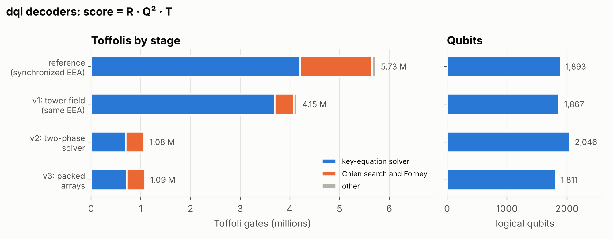

# dqi: a constant-schedule Reed–Solomon decoder for Decoded Quantum Interferometry

Benchmark II of the competition. Decoded Quantum Interferometry (DQI) needs, inside the quantum computer, a decoder
for a Reed–Solomon code over GF(2¹²) with n = 70 syndromes and m = 4,095 positions. The circuit receives the
syndromes in 70 quantum registers and must:

- multiply the amplitude by (−1)^(Σⱼ e_j · M_j), where e is the decoded error and M_j are classical measurement
  outcomes (*measurement-based uncomputation*, MBUC);
- restore the syndromes and return every ancilla to |0⟩.

The verifier simulates 102,400 random shots. The score is R · Q² · T: a repetition factor R that grows with the
error rate (R = 1.19 with zero errors, because of a 2⁻¹²⁸-confidence bound), qubits squared, and Toffolis per shot.

| | Reference decoder | v1: tower field | v2: two-phase solver | **v3: packed arrays** |
|---|---|---|---|---|
| Qubits Q | 1,893 | 1,867 | 2,046 | **1,811** |
| Toffolis per shot T | 5,725,108 | 4,146,652 | 1,075,138 | 1,089,324 |
| Failed shots (of 102,400) | 0 | 0 | 2 | 11 |
| Repetition factor R | 1.191 | 1.191 | 1.201 | 1.232 |
| Score R · Q² · T | 2.444 × 10¹³ | 1.722 × 10¹³ | 5.407 × 10¹² | **4.401 × 10¹²** |
| Improvement | ×1.00 | ×1.42 | ×4.52 | **×5.55** |

All columns come from full official verifications ([`results/`](results/)). Each decoder built from this folder
is byte-identical to the one submitted (v1 `ff4a44db…`, v2 `f296d406…`, v3 `a086a75c…`).



## Where the cost was

The reference decoder (organizers, after Proos and Zalka) solves the key equation σ·S ≡ ω (mod x⁷⁰) with a
reversible *synchronized* extended Euclidean algorithm (EEA). It then evaluates σ and ω at all 4,095 positions
(Chien search) to find the error values (Forney's formula), kicks back the phase, and runs the EEA backwards.
Profiling by ablation (`profile_stages.py`: rebuild with one stage removed, subtract) showed two problems:

- **Field arithmetic is expensive.** Forney spends 315 of its ~350 Toffolis per position on one GF(2¹²) inversion,
  and the EEA does 73 controlled multiplications per iteration.
- **The EEA pays for everything, every iteration.** It cycles through 4 sub-steps (reduce, shift, align, update the
  cofactor), and which one runs depends on the data, so every one of its 222 iterations is built with all of them
  under quantum control. `schedule_analysis.py` shows that each shot spends about 72 iterations in sub-step 0,
  40 in 1, 32 in 2 and 72 in 3: three quarters of the work in each iteration is wasted.

The schedule cannot simply be guessed either. It is nearly the same for all inputs at first, but shots drift off
it at roughly one in 4,000 per division round (about the chance that a GF(2¹²) coefficient is zero): 2% of shots
are off the common schedule by iteration 150 ([`results/schedule_analysis.txt`](results/schedule_analysis.txt)).

## v1: tower-field arithmetic

GF(2¹²) can be built in layers: GF(2³) → GF(2⁶) = GF(2³)[v]/(v² + v + λ) → GF(2¹²) = GF(2⁶)[w]/(w² + w + μ).

- **Multiplication** is Karatsuba at every layer: 3 × 3 × 6 = **54 ANDs** (kickmix's built-in: 63 Toffolis).
- **Inversion** reduces to the subfield: x⁻¹ = conj(x) · N(x)⁻¹, where the norm N(x) = a² + ab + μb² lives in
  GF(2⁶). One more level down, the only inverse left is in GF(2³), where x⁻¹ = x² · x⁴ is a single product of two
  linear functions. Total: **78 ANDs** (built-in: 315).

Every nonlinear step is a *bilinear map*: an AND of a linear form of one register with a linear form of another,
XORed into the output. So each costs exactly one Toffoli per AND, and a register holding a bilinear form is cleared
for free by measuring it in the X basis and fixing the phase with CZ gates. The change of basis between kickmix's
polynomial basis and the tower basis is a 12 × 12 GF(2) matrix folded into the forms. Forney also gates the inverse
instead of the result: the "σ(x) = 0" flag ANDs the 3-bit GF(2³) norm (3 Toffolis), and a zero norm propagates to a
zero inverse. Keeping the reference EEA, this gave ×1.42.

## v2: a key-equation solver with a fixed schedule

The real fix is an algorithm whose sequence of operations does not depend on the data, so the circuit only builds
what each step needs. The key equation is a Padé problem, and Bernstein–Yang *divsteps* solve it in exactly n
steps, each with the same shape. On the reversed polynomials (f = reversed x⁷⁰, g = reversed S):

```
phase 1, t = 0 .. 69:
    swap_t = (δ > 0) and g(0) ≠ 0;   if swap_t: (f, g) ← (g, f), δ ← −δ
    c_t = g(0) / f(0);   g ← (g + c_t f) / x;   δ ← δ + 1
```

Two things make this cheap and reversible on a quantum computer:

1. **The division by x is free.** After the update g(0) = 0, so dividing by x just relabels g's registers. The
   register freed at the bottom is exactly where c_t goes. The quotients that make each step reversible cost no
   extra space, because the remainders shrink by one coefficient per step as the stash grows by one.
2. **σ and ω come from replaying the stash.** Phase 2 multiplies the transition matrices from the right,
   v ← v · T_t · P_t with T_t = [[x, 0], [c_t, 1]], starting from v = (0, 1) and going from t = 69 down to 0. The new
   constant coefficient of v_f is c_t · v_g(0), so each c_t is uncomputed right away from v itself (one inverse,
   one multiply). The stash empties as v grows, and at the end v = (ω_rev, σ_rev).

Forney then evaluates the reversed polynomials directly: an error sits where σ_rev(α^j) = 0, with value
α^(−70 j) · ω_rev(α^j) / (α^j σ_rev'(α^j)).

The circuit's register layout is fixed classically: how many registers each polynomial may occupy at each step,
which positions a swap or a multiply sweep touches, which registers are zero and can be reused. `model/` holds a
classical implementation of the algorithm. `model/bounds.py` runs it on 118,000 simulated shots (100,000 random,
plus 1,000 per error weight from 18 to 35), takes the per-step maxima and writes [`bounds_k20.json`](bounds_k20.json).
The layout is sized for error weights of at least 20. Lighter errors have probability ~10⁻⁵ and may fail (about 1.4
expected in 102,400 shots), the likely cause of the 2 failed shots, which cost 0.8% through R. Supporting weight 19 would cost 12 more qubits, worth
about 1.2%.

Results against v1:

- the key-equation solver drops from 3.7 M to 0.70 M Toffolis (phase 1: 512 k, phase 2: 186 k, both directions);
- Forney stays at 377 k (92 Toffolis per position) and is now 35% of the total;
- Q rises by 179 qubits: the 70 stored swap bits plus the room for low-weight errors, whose f keeps its length.

## v3: the same algorithm in fewer qubits

With T down by 4×, qubits (squared in the score) became the lever. v2 spent them in two places:

- **Separate arrays for f and g.** A single shot never needs more than ~141 coefficients for f, g and
  the stash together, but sizing f and g separately reserved 156. Errors of low weight end with a long f and a
  short g, full-weight errors with both at about 35. v3 keeps f and g in **one array**: f from the bottom, g
  reversed from the top. Every operation pairs position i with len − 1 − i. Swaps and sweeps then act on
  disjoint zones for the shots that need them, and do nothing (c = 0, no swap) for the others. Dividing g by x
  pops the array's top register into the stash, so array plus stash stay at a constant 143 registers.
- **70 stored swap bits.** The swap of step t can be recomputed after the step as
  (δ_{t+1} ≤ 0) and (c_t ≠ 0). The rule is exact except after a non-swap elimination with δ < 0, which
  happens in about 0.7% of shots. The step index of such an *exception* goes into a 7-qubit register X.
  Phase 2 runs δ backwards with the same rule and checks X, then clears the bit with
  (δ_t ≥ 1) and (v_f(0) ≠ 0), which holds right after the swap. A shot with two exceptions fails
  (7 in 100,000).

Smaller savings: the GF(2³) inverse is computed in place instead of on a copy (3 qubits), registers are
returned to the builder instead of being kept in reserve, and idle syndrome registers stand in for array
registers during Forney. In total, Q went from 2,046 to 1,811 for +1.3% of Toffolis and about 9 more failed shots
(R +2.5%): ×1.23 on the score.

`model/packed.py` checks both changes on the classical model: the packed layout reproduces every stashed
quotient on 30,000 shots, and the exception rule fails only in shots with two exceptions.

## Testing

- `model/two_phase.py`: on random shots, σ has its roots exactly at the error positions, every quotient pops
  cleanly, and the Forney formula gives every error value.
- `tests/test_tower.py`: the tower circuits are simulated with kickmix and checked for value, clean ancillas and no
  stray phase:
  - multiplication on 4,096 random triples, exactly 54 Toffolis;
  - inversion on **all** 4,096 inputs, gated and ungated, exactly 78 and 81 Toffolis;
  - the basis change is a field isomorphism.
- `tests/test_tower.py` also covers the lean inverse of v3 (all 4,096 inputs, 3 fewer ancillas).
- `tests/test_two_phase.py`: the classical model, and the full v3 circuit on 2,560 verifier shots.
- `tests/test_decoder_tower_eea.py`: v1 passes the verifier on a small instance.

```bash
export COMP_DIR=/path/to/competition-data      # folder with kickmix/ and verifiers/
python -m pytest dqi/tests -q                   # 9 tests, about a minute
python dqi/model/two_phase.py 400               # classical check of the algorithm
python dqi/decoder.py dqi.kmb                   # the submitted circuit (v3), ~1 min, 485 MB
python "$COMP_DIR/verifiers/dqi/verify_submission_dqi.py" dqi.kmb
```

The official verifier also reports `reaction_depth`, which needs more RAM than a 7 GB machine has. It is not part of
the score; the Kaggle notebooks fall back to a copy of the verifier without that line when they run out of memory.

## What is left

- **Failed shots.** 11 of 102,400, costing 3.4% through R. A second exception register (7 qubits) would remove
  the double-exception failures; supporting error weight 19 would cost one more register.
- **v_f and v_g** in phase 2 could share one array the same way f and g do (about 2 registers).
- **Forney**, now 35% of the Toffolis, is close to its floor with this approach: 11 Toffolis for the zero test
  and 81 for the gated inverse, at each of 4,095 positions.

## Files

| File | Role |
|---|---|
| `decoder.py` | v3, the submitted decoder: `TwoPhaseDecoder` builds `dqi.kmb` |
| `decoder_v2.py` | v2: the same algorithm with separate f and g arrays and stored swap bits |
| `bounds_k20.json` | Per-step register layout used by `decoder.py` |
| `model/` | Classical model: field (`gf.py`), algorithm (`two_phase.py`), layout bounds (`bounds.py`), v3 checks (`packed.py`) |
| `tower.py` | Tower field: classical arithmetic, basis change, bilinear term lists, quantum emitters, `TowerInverse` |
| `decoder_tower_eea.py` | v1: the reference EEA with tower-field arithmetic |
| `tests/` | Simulation tests (see above) |
| `profile_stages.py` | Toffolis per stage by ablation, for the three decoders (`results/stage_profile.csv`) |
| `schedule_analysis.py` | Sub-step schedule of the reference EEA across random inputs |
| `kaggle_notebook_v1.ipynb` … `_v3.ipynb` | The Kaggle notebooks that built, verified and packaged each submission (sources embedded) |
| `results/` | Official verifier outputs and analysis tables |
